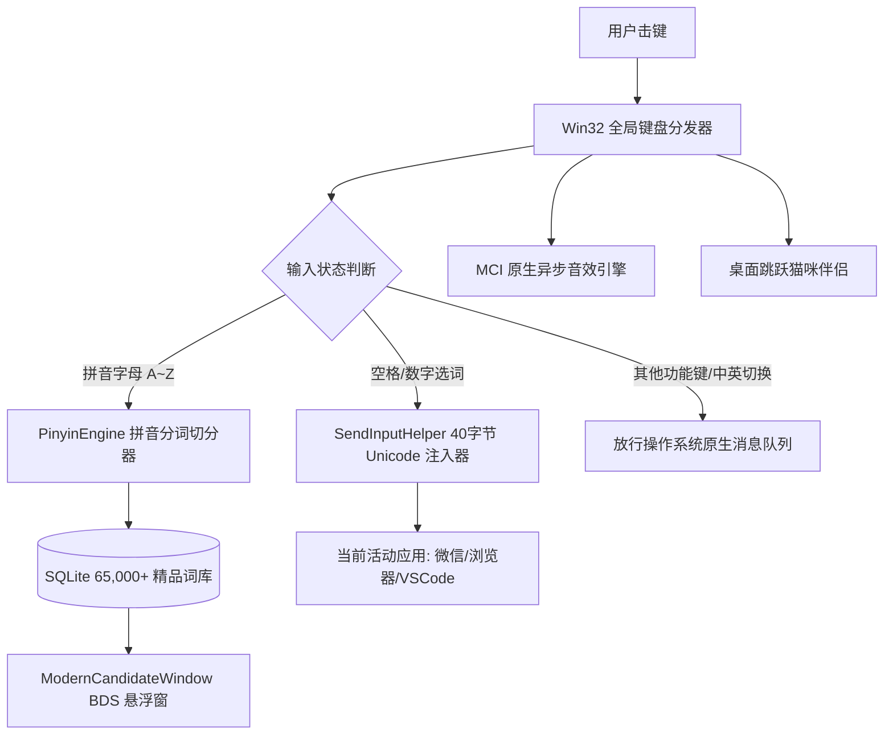

<div align="center">

# 🐾 BDS-IME · 专属拼音输入法

**专为 Windows 打造的轻量独立输入法 · BDS 皮肤原生渲染 · 原汁原味打字音效 · 治愈系桌面伴侣**

[](https://github.com/HMuSeaB/bds-ime/releases)
[](https://microsoft.com)
[](LICENSE)
[](.github/workflows/release.yml)

</div>

---

## 🌟 核心特性 (Features)

- 🌸 **BDS 皮肤原生解析与移植**：独家支持百度手机输入法 `.bds` 格式（包括 ZIP 伪加密破译、9-Patch 切片还原、色彩样式提取），将手机端的可爱皮肤完美搬上 Windows 桌面！
- ⚡ **超轻量自研输入核心**：
  - 纯 SQLite 驱动的 **65,133 条**现代汉语精选词库，首选词命中率极高；
  - 毫秒级正向最大匹配拼音切分算法（如 `shuishanshurufa` ➔ `shui'shan'shu'ru'fa`）；
  - 原生 Win32 Unicode 文本注入，通杀记事本、微信、浏览器、Office 与各大文本编辑器。
- 🎵 **多声道原声按键音效**：支持原版 BDS 击键音效包，MCI 4 虚拟声道循环混音，飞速打字也绝不丢音。
- 🐾 **打字伴侣小猫 (Desktop Pet)**：击键触发像素猫咪可爱起跳与踩奶动画，治愈每一次敲击。
- 📦 **工业级发布支持**：
  - **安装向导 EXE**：使用 Inno Setup 打包的单文件安装向导 `BDS-IME-Setup-v1.0.0.exe`，支持一键安装、创建桌面快捷方式与干净卸载；
  - **绿色免安装包**：`BDS-IME-Portable.zip` 解压即用；
  - **GitHub Actions 自动化发布**：推送版本 tag 即可由云端服务器自动编译并发布二进制资产到 GitHub Releases！

---

## 🏗️ 架构设计 (Architecture)



---

## 🚀 下载与安装 (Installation)

### 方式 1：下载安装包 (推荐)
1. 前往 [GitHub Releases](https://github.com/HMuSeaB/bds-ime/releases) 页面；
2. 下载 `BDS-IME-Setup-v1.0.0.exe`；
3. 双击运行安装向导，一路点击【下一步】即可完成安装。

### 方式 2：绿色免安装版
1. 下载 `BDS-IME-v1.0.0-Windows-x64-Portable.zip`；
2. 解压至任意目录，双击 `BDS-IME.exe` 即可使用。

---

## 🛠️ 本地编译与构建 (Build from Source)

本项目完全开源，无需繁杂配置即可在 Windows 本地一键构建：

```powershell
# 1. 克隆代码仓库
git clone https://github.com/HMuSeaB/bds-ime.git
cd bds-ime

# 2. 安装构建依赖
pip install pyinstaller pillow

# 3. 一键编译为独立 EXE 与发布 Zip
python scripts/build_release.py
```

编译输出物将自动生成在 `dist/` 目录下：
- `dist/BDS-IME/BDS-IME.exe` (独立可执行文件)
- `dist/BDS-IME-v1.0.0-Windows-x64-Portable.zip` (绿色发布包)

---

## 🕹️ 快捷键与操作说明

| 按键 / 操作 | 功能描述 |
| :--- | :--- |
| **A ~ Z** | 敲击拼音字母，弹出 BDS 候选窗口并播放击键音效 |
| **Space (空格)** | 选取第 1 候选词上屏 |
| **1 ~ 5** | 选取对应序号候选词上屏 |
| **Backspace** | 删除末尾拼音字母 |
| **Delete / Esc** | 取消当前拼音输入并隐藏候选浮窗 |
| **Shift** | 切换中 / 英文输入状态 |
| **右键右下角药丸** | 安全退出输入法 |

---

## 📄 开源许可证 (License)

本项目基于 [MIT License](LICENSE) 协议完全开源，欢迎提 Issue、PR 或 Star 支持！
